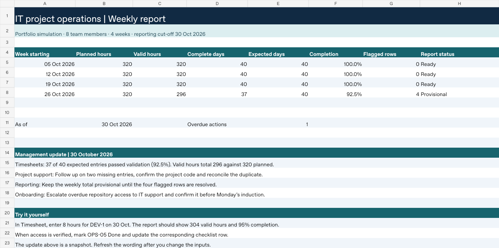

# IT Project Operations | Excel Portfolio

A four-week simulation for an eight-person software development team. The project lead needs a weekly view of reported hours, data quality, open actions and access readiness. All data and ticket references are fictional.

## Workbook

Download [IT_Operations.xlsx](IT_Operations.xlsx) and open it in Excel.

| Sheet | Purpose |
| --- | --- |
| Report | Weekly planned and validated hours, completion, overdue actions and an English management update |
| Timesheet | Daily entries and formula checks for blanks, duplicates, unknown project codes and invalid hours |
| Actions | Issue owners, deadlines, statuses and next steps |
| Access | Onboarding and offboarding tasks with approval and verification evidence |

## Findings for 26–30 October 2026

- 37 of 40 expected entries passed validation. The report shows 296 valid hours against 320 planned.
- Four rows require follow-up: two missing entries, one unknown project code and one duplicate.
- Repository access is overdue for a joiner due to start on Monday. The action register assigns IT support to escalate and verify access.

## Try the workbook

1. Enter 8 hours for DEV-1 on 30 October in **Timesheet**. In **Report**, verify that the final week shows 304 valid hours, 95% completion and three flagged rows.
2. Mark OPS-05 as **Done** in **Actions**. The overdue count should drop from one to zero. Update **Access** separately after verifying the permission.
3. Restore the original values to reproduce the management update. That update is a written snapshot. The metrics and deadline checks recalculate from the workbook inputs.

The workbook uses one expected entry per team member per day. Duplicate detection keeps the first occurrence and flags later occurrences for review. The scenario has four fixed weeks and a fixed reporting cut-off.

## Recalculation check

The table shows the effect of filling in the missing eight hours for DEV-1 and then closing OPS-05 in the simulation.

| Metric for 26–30 October | Original scenario | After both edits |
| --- | ---: | ---: |
| Valid hours | 296 | 304 |
| Validated entries | 37 of 40 | 38 of 40 |
| Completion | 92.5% | 95.0% |
| Flagged rows | 4 | 3 |
| Overdue actions | 1 | 0 |
| Report status | Provisional | Provisional |

The weekly report remains **Provisional** because one missing entry, one unknown project code and one duplicate still need review. Closing the access issue changes the overdue-action count. The time-reporting status depends on the timesheet flags.

## CV entry

> **IT Project Operations | Excel Portfolio** — Excel case study for a simulated eight-person software team, covering weekly time reporting, data-quality checks, and tracking onboarding and access issues by owner, deadline, and status.

Add a link to this repository alongside the project title.
